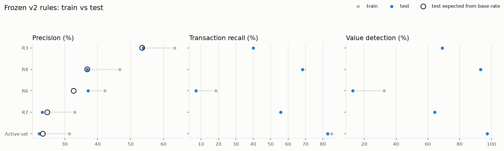

# TxnPulse — Transaction-Monitoring Rules System

TxnPulse runs on simulated card data and covers the work of a bank's fraud rules team:
- write transaction-monitoring rules in SQL
- test them like UAT
- tune them on one period
- freeze them
- validate them unchanged on a later period

It is a rules-first project: every alert comes from a readable IF-ELSE rule with a version,
an owner, a test suite and a documented reason for its threshold.

The current rule set is v2.1: rule set v2 with R6 moved to shadow after validation. Rule
set v2 is frozen at git tag `rules-v2` and is the version validated on the test period. The
pre-tuning set is at `rules-v1.1`.

## 1. Problem
A fraud operations team can only review a limited number of alerts a day. Rules that catch
fraud but flood the queue don't protect customers, because alerts beyond capacity go
unworked. The goal here is to:
- catch as much fraud, by count and by value, as possible within an alert budget
- keep each rule explainable
- prove the result holds on data the rules never saw

## 2. Data
Kaggle "Credit Card Transactions Fraud Detection" (kartik2112), generated with the Sparkov
simulator.

| Period | File | Dates | Transactions | Fraud | Fraud value |
|---|---|---|---|---|---|
| Train | fraudTrain.csv | 2019-01-01 to 2020-06-21 (537 days) | 1,296,675 | 7,506 (0.579%) | $3,988,088.61 |
| Test | fraudTest.csv | 2020-06-21 to 2020-12-31 (194 days) | 555,719 | 2,145 (0.386%) | $1,133,324.68 |

- **No overlap:** the periods do not overlap (test starts 48 seconds after train ends).
- **Clean data:** no nulls, duplicate IDs or non-positive amounts
  (`sql/02_dq_checks.sql`).
- **Data minimisation:** names, street, gender, date of birth and job are dropped at load
  and never reach any table.
- **Cleaning decisions:** `unix_time` does not match the timestamp (it is shifted back 7
  years), so it is not used. Card numbers are masked in every output.

Details: [reports/data_dictionary.md](reports/data_dictionary.md).

**Two design choices shape everything that follows:**
- **Thresholds come from train only.** The EDA code drops the test table before it runs,
  sweeps run only on train, and the R8 risk list is built only from train.
- **The test run carries history.** It loads train rows as unscored history, so a card's
  windows (30-transaction average, 30 active days, first merchant visit) continue across the
  split. Only test rows count in metrics.

## 3. Rules
All rules read one table, `txn`, and write one boolean column each to `flags`
([sql/10_features_and_flags.sql](sql/10_features_and_flags.sql); R8 in
[sql/15_r8_risk_list.sql](sql/15_r8_risk_list.sql)).
- Every window ends at the current transaction.
- Baselines exclude the current transaction (R2) or the current day (R7).
- Same-second transactions are taken in `(ts, trans_num)` order.

| ID | Version | Status (set v2.1) | Logic | Action |
|---|---|---|---|---|
| R1 | 1.1 | Retired | 5 or more transactions on the card in 60 minutes | ALERT |
| R2 | 1.0 | Retired | amt > 5 x average of the previous 30 transactions | STEP_UP |
| R3 | 2.0 | Active | Hour 22:00-03:59 and amt > 600 | HOLD_CONFIRM |
| R4 | 2.0 | Active | amt > 600 in shopping_net, misc_net, shopping_pos; amt > 250 in grocery_pos | ALERT |
| R5 | 1.0 | Retired | Cardholder-to-merchant distance > 100 km | ALERT |
| R6 | 2.0 | Shadow (active in v2) | First visit to the merchant, 10 or more prior transactions, amt > 750 | STEP_UP |
| R7 | 2.0 | Active | 7 or more prior active days and 48-hour spend > 5 x two days of average daily spend | HOLD_CONFIRM |
| R8 | 1.0 | Shadow | Merchant on risk list v1 (built from train only); scored on test only | BLOCK / HOLD_CONFIRM by tier |

- **Status** lives in a rule catalogue (`sql/20`). Retired rules are still computed for
  monitoring; shadow rules are measured but do not alert.
- **Full entries** (business intent, IF-ELSE logic, thresholds and rationale, fields, UAT
  IDs, train and test performance, owner and date) are in
  [reports/rule_register.md](reports/rule_register.md).

## 4. Rule testing (UAT)
[tests/uat_cases.csv](tests/uat_cases.csv) holds 50 hand-written scenarios (220
transactions), including:
- below / at / above every threshold
- the start and end of each window
- midnight wrap
- duplicate timestamps
- cards with no history
- risk-list matches

Each case is loaded as `txn` and run through the production SQL unchanged. The suite needs
no Kaggle data and runs in CI on every push and pull request
([.github/workflows/uat.yml](.github/workflows/uat.yml)).

**Results:**
- UAT found two real defects, DEF-01 and DEF-02. The R1 and R7 time windows counted
  same-second transactions that sort after the current one. They were fixed (R1 and R7
  v1.1), and 0 flags changed on train.
- When thresholds moved to v2, the suite failed exactly the 10 boundary cases built on v1
  values. Those cases were rewritten in the same change.
- All 50 cases pass. Report and defect log: [reports/uat_report.md](reports/uat_report.md).

## 5. Tuning (train only)
Every rule was swept over a grid of settings (`sql/40_sweeps_train.sql`), and candidate
rule sets were compared on combined workload. A rule had to add fraud that the others did
not catch (leave-one-out).

| Change | Evidence on train |
|---|---|
| R5 retired | Precision 0.53-0.58% at every distance from 25 to 125 km, the same as the 0.579% base rate |
| R2 retired | Even tuned (5x, amt > 500), it adds 4,573 alerts for 25 fraud on top of the other rules |
| R1 retired | Adds 466 alerts for 5 fraud; wider windows only lower precision |
| R4 per-category thresholds re-tuned | grocery_pos 300 to 250 adds 613 fraud for 798 alerts; the other three, 500 to 600, cut 1,877 alerts for 3 fraud |
| R7 from 24 h / 3x to 48 h / 5x | 178.01 to 23.60 alerts per day; precision 6.09% to 33.01% |
| R3 500 to 600 | The $500-600 band adds 916 alerts for 27 fraud (2.9% precision on those alerts) |
| R6 300 to 750 | Precision 17.14% to 42.21%; alerts 23.15 to 6.09 per day |

**The alert budget is 50 alerts per day.** This is a stated assumption (one analyst at
about 9 minutes per alert), not a measured figure. Workload is also reported as cases: an
alert plus any further alerts on the same card within 24 hours.

Report: [reports/tuning_report.md](reports/tuning_report.md).

## 6. Post-deployment validation (test, frozen rules)
The frozen v2 set was tagged, then run once on the test period with no changes.

**Precision:**
- **The drop is expected:** test has fewer frauds per transaction (0.386% against 0.579%),
  so precision falls even for an unchanged rule.
- **How it was checked:** for each rule I computed the precision it would have on test if
  it kept its train recall and its train alert rate on genuine payments.
  - **R4:** 36.83% expected, 36.83% actual.
  - **Active set:** 23.35% expected, 22.21% actual.
- **So drift is judged on recall, value detection and cases per day.**

**Findings:**
- **R6 decayed.** It relies on first visits to a merchant, which fall from 94.16% of
  transactions in January 2019 to 7.17% in December 2020, as cards build history. Its train
  numbers were partly a warm-up artifact: on the last 3 months of train it already showed
  9.54% recall, against 7.04% on test. It was moved to shadow in rule set v2.1 through
  the pull request process.
- **R8 is not promoted:** 1.12% precision at 31.66 alerts per day, and 0 fraud that the
  active rules miss.
- **16 cards appear only in the test period** and carry no history. All 16 were detected,
  by R4 and R3.

Report: [reports/pvt_report.md](reports/pvt_report.md).

## 7. Results (rule set v2, active rules R3, R4, R6, R7)

| Metric | Train (tuned on) | Test (frozen, unseen) |
|---|---|---|
| Alerts per day | 37.80 | 41.20 |
| Cases per day | 17.21 | 18.78 |
| Precision | 31.40% | 22.21% (23.35% expected from the lower base rate) |
| Transaction recall | 84.92% | 82.75% |
| Value detection | 98.04% | 97.41% |
| Compromised cards detected | 755 of 762 | 215 of 218 |
| Loss before first alert, median per card | 0 txns / $0 | 0 txns / $0 |
| Loss before first alert, P90 per card | 1 txn / $22.21 | 2 txns / $34.42 |

**Compared with the starting rule set** (all seven v1 rules on train):
- 723.12 alerts per day at 1.77% precision
- 91.58% recall and 98.48% value detection

v2 cuts alert volume by 95% for 6.7 points of transaction recall and 0.4 points of value
detection.

**Peaks:** both Decembers exceed the alert budget, at 74.32 alerts per day (2019) and 65.13
(2020), because transaction volume doubles. They stay under it in cases (32.42 and 27.42
per day). This is treated as a peak-staffing finding, not a reason to change thresholds.

**Rule set v2.1 (R6 in shadow):**

| | Alerts per day | Cases per day | Precision | Recall | Value detection |
|---|---|---|---|---|---|
| Train | 37.36 | 16.79 | 31.77% | 84.92% | 98.04% |
| Test | 41.02 | 18.63 | 22.30% | 82.75% | 97.41% |

The test figures for v2.1 are an impact estimate, not out-of-sample validation. The change
was decided after seeing the test period.



## 8. ML alert prioritisation
The rules decide what is alerted. A gradient-boosting model (scikit-learn
HistGradientBoostingClassifier) decides the order in which each day's alerts are reviewed.

- **Training data:** train-period alerts from the active v2.1 rules (20,063 alerts).
- **Features:** past-only, with no R8 (its list was built from train labels) and no labels.
- **Model choice:** settings and training window were chosen on a time-based validation
  split inside train. The test period was scored once at the end.

Results on the test period, from daily queues. Value@K is the **share of fraud value in the
alert queue**: fraud amount in the reviewed alerts, divided by the fraud amount of all alerts
($1,104,004.34). It is not a share of all fraud.

| Ranking | PR-AUC | Precision@10 / day | Value@10 / day | Value@20 / day |
|---|---|---|---|---|
| Model score | 0.9768 | 65.57% | 73.14% | 94.54% |
| Rules fired | 0.5210 | 45.57% | 70.08% | 90.02% |
| Strongest action | 0.3288 | 37.99% | 60.41% | 85.13% |
| Amount | 0.2599 | 25.05% | 43.07% | 82.01% |

- **As a share of ALL test fraud value** ($1,133,324.68, alerted or not), the model's
  value@10 and value@20 are 71.25% and 92.09%, against 68.27% and 87.69% for rules fired.
- **At case level** (alerts on a card within 24 hours count once, ranked by the opening
  alert), the model's top 10 cases per day cover 99.03% of the fraud value in the alert
  queue (96.47% of all fraud value), against 63.49% for rules fired.
- **A monotonic-constrained candidate was tried and not adopted.** It forces the score to
  rise with amount, which fixes a $1,320 fraud the model scored near zero. It lost on the
  validation split (PR-AUC 0.9512 against 0.9840) and does not help against threshold
  gaming.
- **Operating model:** the ranker orders the queue but never suppresses an alert.
  HOLD_CONFIRM alerts are always worked regardless of score, and a daily random sample of
  low-scored alerts is reviewed.

Other parts of the phase:
- **SHAP reason codes** for every alert.
- **An alert-note prompt template** (no API calls).
- **A threshold-gaming test.** Fraud placed just under thresholds is often still caught by
  R7, but the model ranks it low, because it learned the simulator's fraud bands. That is a
  documented limitation.

Report: [ml/model_report.md](ml/model_report.md).

## 9. Limitations
- **Simulated data.** Fraud sits in narrow category, hour and amount bands, and its shape
  is the same in both periods. Precision here is higher than real card data would give.
  PVT tests stability under a lower fraud rate and higher volume, not new fraud patterns.
- **Thresholds sit near the simulator's fraud bands:** R4 at $600, grocery_pos at $250, R6
  at $750. No upper amount caps were used, although train has no fraud above $1,500; that is
  a generator artifact.
- **Assumptions:**
  - the alert budget (one analyst, about 9 minutes per alert)
  - the $5 review cost in net benefit
  - net benefit counts a caught fraud as fully recovered
- **Rules retired on this data** (velocity, distance) matter for fraud types this simulator
  does not generate, such as card testing and card-present fraud.
- **R8 matches merchants by exact name;** a production list would key on a merchant ID.
- **trans_num is a random ID,** so the order of same-second transactions is deterministic
  but not real arrival order.
- **The ML ranker is fitted to simulator patterns:** its PR-AUC (0.98) is far above what
  real data would allow, and it ranks fraud outside the simulator's bands low. See the
  model report.
- **The test period can no longer validate later changes.** Any rule change made because
  of the test results (such as R6 to shadow) has seen that period. Test figures for such a
  version are an impact estimate, not out-of-sample validation.

## 10. How to reproduce
1. Put the Kaggle files `fraudTrain.csv` and `fraudTest.csv` in `data/`.
2. Run:
   ```
   py -3.12 -m venv .venv
   .venv\Scripts\python.exe -m pip install -r requirements.txt
   .venv\Scripts\python.exe run_all.py
   ```

`run_all.py` reruns, in order:
1. data-quality checks and train-only EDA
2. R8 risk list build
3. rules and sweeps on train
4. frozen rules on test
5. the train-vs-test comparison
6. charts
7. the ML alert ranker (validation inside train, test scored once)
8. the threshold-gaming test
9. ML charts
10. the UAT report table
11. pytest

It takes about a minute and writes to `outputs/` (not committed), `reports/figures/`,
`ml/figures/` and the results table in `reports/uat_report.md`. The tests on their own (no data needed):
`.venv\Scripts\python.exe -m pytest tests`.

To see one day's alert queue for the active rules (time, masked card, category, amount, rules fired, strongest action, fraud yes/no), run `.venv\Scripts\python.exe src/show_alerts.py --period test --date 2020-12-21 --top 20`.

| Folder | Contents |
|---|---|
| `sql/` | load, DQ, EDA, macros, features and flags, R8, performance, metrics, profile, sweeps, risk list, PVT views, ML features |
| `src/` | pipeline scripts (`db.py` shared helpers, `run_rules.py`, `profile_data.py`, `build_risk_list.py`, `compare_pvt.py`, `make_figures.py`, `uat.py`, `run_uat.py`) |
| `tests/` | `uat_cases.csv`, `test_rules.py`, `test_ml_features.py` (leakage tests for the ML features) |
| `ml/` | ML alert ranker: features, training, ranking metrics, SHAP reason codes, gaming test, alert-note template, model report and figures |
| `rules/risk_lists/` | versioned R8 merchant risk list |
| `reports/` | data dictionary, rule register, UAT, tuning and PVT reports, figures, UAT evidence |
| `.github/` | CI workflow and pull request template for rule changes |

Changes are recorded in [CHANGELOG.md](CHANGELOG.md). Rule changes go through the pull
request template ([.github/pull_request_template.md](.github/pull_request_template.md)):
backtest before and after, PVT, UAT evidence, workload impact, rollback plan and
maker/checker sign-off.
