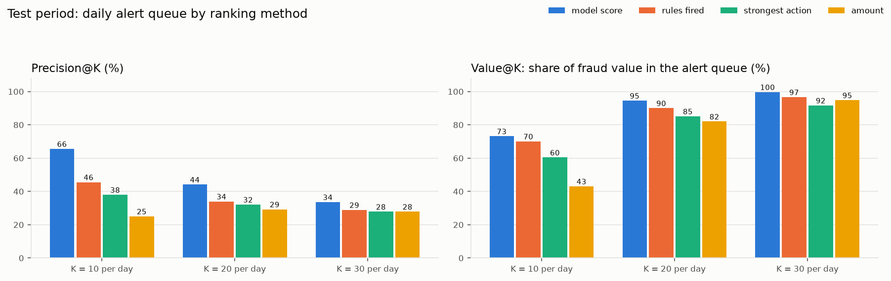
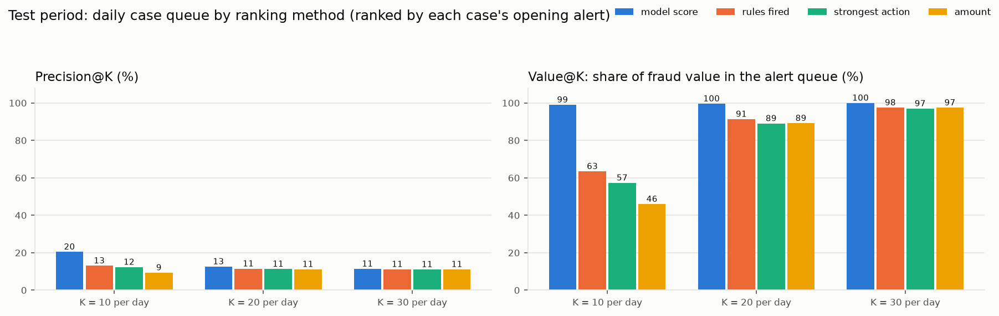
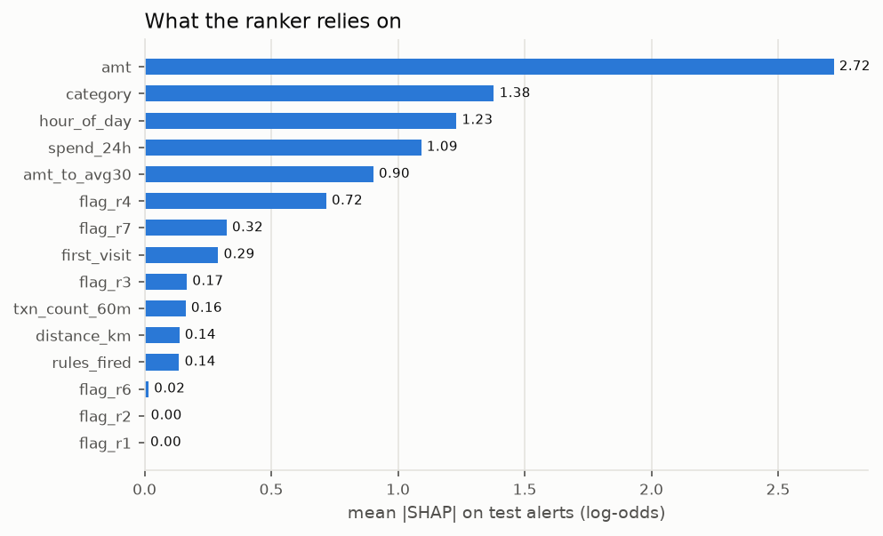

# ML alert prioritisation: model report

The rules decide **what** is alerted (rule set v2.1: R3, R4, R7 active). The model decides
**in what order** an analyst works each day's alerts. It never creates or removes an alert,
and no rule changed in this phase.

| Item | Value |
|---|---|
| Training rows | Train-period transactions where at least one active v2.1 rule fired: 20,063 alerts, 6,374 fraud (2019-01-01 to 2020-06-21) |
| Evaluation rows | The same from the test period: 7,958 alerts, 1,775 fraud (2020-06-21 to 2020-12-31), scored once at the end |
| Documented model | **Model v1:** HistGradientBoostingClassifier, class_weight balanced, learning_rate 0.1, max_leaf_nodes 15, max_iter 400, fitted on all train alerts |
| Candidate not adopted | A monotonic-constrained gradient-boosting model (section 4). It lost to v1 on validation, and its test figures are an impact estimate only. |
| Chosen on | A validation split inside train (alerts from 2020-04-01 onwards). The test period was not used to choose anything. |
| Code | `sql/60_ml_alert_features.sql`, `ml/features.py`, `ml/train_ranker.py`, `ml/ranking.py`, `ml/explain.py`, `ml/gaming_test.py`, `ml/alert_note.py`, `ml/make_ml_figures.py` |
| Outputs | `outputs/ml/*.csv`, `model.pkl` (the documented model), `model_v1.pkl`, `model_monotonic.pkl` and `model_decision.json`, all regenerated by `run_all.py`; charts in `ml/figures/` |

## 1. Results (test period, daily queues)
Each method ranks the same alerts within each day; the analyst reviews the top K per day.
- **Precision@K:** fraud items among those reviewed, pooled over all 194 days.
- **Value@K, share of fraud value in the alert queue:** fraud amount in the reviewed items,
  divided by the fraud amount of all alerts in the period. On test that is $1,104,004.34:
  the fraud the active rules alerted on.
  - It is **not** a share of all fraud. The rules alert on 97.41% of test fraud value, so
    100% of the queue equals 97.41% of all fraud.
  - Each table below also gives value@K as a share of ALL test fraud value
    ($1,133,324.68, alerted or not).
- **Queue sizes:** K comes from train alert volume (median 33 alerts per day, 25th
  percentile 22). Queues at or below a typical day are where order matters; test volume is
  similar (median 36).

### Alert level

Value columns are the share of fraud value in the alert queue.

| Ranking | PR-AUC | Precision@10 | Precision@20 | Precision@30 | Value@10 | Value@20 | Value@30 |
|---|---|---|---|---|---|---|---|
| **Model score** | **0.9768** | **65.57%** | **44.15%** | **33.61%** | **73.14%** | **94.54%** | **99.69%** |
| Rules fired (ties by amount) | 0.5210 | 45.57% | 33.99% | 28.91% | 70.08% | 90.02% | 96.64% |
| Strongest action (ties by amount) | 0.3288 | 37.99% | 32.12% | 27.84% | 60.41% | 85.13% | 91.68% |
| Amount | 0.2599 | 25.05% | 29.27% | 27.88% | 43.07% | 82.01% | 94.80% |

**As a share of ALL test fraud value** at K = 10 / 20 / 30:
- model: 71.25% / 92.09% / 97.11%
- rules fired: 68.27% / 87.69% / 94.14%
- strongest action: 58.84% / 82.93% / 89.31%
- amount: 41.96% / 79.89% / 92.35%

At K = 10 per day, the model's queue holds 1,272 fraud alerts over the period, against 884
for rules fired (+44%).



### Case level
Alerts on the same card within 24 hours of a case's opening alert form one case: 3,614 test
cases, matching `case_volume.csv`.
- **Ranking:** each case is ranked by its **opening alert's** score, the only information
  available when the case opens. Later alerts never affect its rank.
- **Labels:** a case is fraud if any of its alerts is fraud, and its value is the fraud
  amount across all its alerts.

Value columns are the share of fraud value in the alert queue.

| Ranking | PR-AUC | Precision@10 | Precision@20 | Value@10 | Value@20 | Value@30 |
|---|---|---|---|---|---|---|
| **Model score** | **0.8990** | **20.49%** | **12.61%** | **99.03%** | **99.61%** | **100.00%** |
| Rules fired | 0.1601 | 13.09% | 11.46% | 63.49% | 91.38% | 97.52% |
| Strongest action | 0.1018 | 12.36% | 11.34% | 57.36% | 89.08% | 97.00% |
| Amount | 0.0785 | 9.38% | 11.21% | 46.00% | 89.20% | 97.49% |

- **Why case precision looks low:** there are only about 2 fraud cases per day (398 over
  the period). Precision@K at case level is capped well below 100% for any ranking once K
  is above that.
- **The useful number is value@K:** reviewing the model's top 10 cases per day covers
  99.03% of the fraud value in the alert queue, against 63.49% for rules fired.
- **As a share of ALL test fraud value** at K = 10 / 20 / 30: model 96.47% / 97.04% /
  97.41%; rules fired 61.85% / 89.02% / 95.00%.



## 2. Data, features and leakage controls
**Features** (`sql/60_ml_alert_features.sql`), all taken from `sql/10`, where every window
ends at the current row and baselines exclude it:

| Feature | Meaning |
|---|---|
| amt | Transaction amount |
| amt_to_avg30 | Amount divided by the card's average of its previous 30 transactions (missing if no history) |
| txn_count_60m | Card's transactions in the last 60 minutes, including this one |
| spend_24h | Card's spend in the last 24 hours, including this one |
| hour_of_day | Hour, 0 to 23 |
| category | Merchant category, one-hot with levels fixed from train |
| distance_km | Cardholder home to merchant |
| first_visit | First transaction of this card at this merchant |
| rules_fired | Number of R1 to R7 flags on the transaction |
| flag_r1 to flag_r7 | Individual rule flags: active (R3, R4, R7), shadow (R6) and retired (R1, R2, R5) |

**Excluded on purpose:**
- **R8:** its risk list was built from train labels, so `r8` on train rows is label
  leakage. The feature path never runs `sql/15`, and the model matrix refuses any R8 column.
- **Labels:** `is_fraud` is the target only. There are no past-label features (card or
  merchant fraud history), because labels arrive late in production.
- **Identifiers and personal data:** card number, names, address, home coordinates and city
  population are not features.

**Leakage tests** (`tests/test_ml_features.py`, 6 tests, all pass):
- **R8 present in `flags`:** the features still contain no R8 column, and `rules_fired`
  counts R1 to R7 only.
- **Forbidden columns:** the model matrix has no label, ID or R8 columns, and raises an
  error if one is added to the feature list.
- **No future data:** adding later transactions to a card changes none of its earlier
  feature values.
  - I checked this test against a deliberately leaky feature (a forward-looking spend
    window) and it failed as it should.
- **No labels:** flipping every label leaves every feature unchanged.
- **Category columns** are fixed by the training levels.

## 3. Choosing the model (validation inside train only)
- **Split:** fit on alerts before 2020-04-01; validate on alerts from 2020-04-01 to
  2020-06-21 (3,214 alerts, 997 fraud).
- **Candidates:**
  - logistic regression (median imputation with a missing flag, standardised,
    class_weight balanced) as the baseline
  - HistGradientBoostingClassifier with class_weight balanced: learning_rate {0.05, 0.1}
    by max_leaf_nodes {15, 31} by max_iter {200, 400}
- **Warm-up check:** every candidate was fitted on two windows, all of train and 2019-07-01
  onwards, because history features are unreliable while cards are new (first-visit share
  falls from 94% to 13% across train).

Best of each family and window (`validation_search.csv`):

Value columns are the share of fraud value in the validation alert queue.

| Window | Model | Fit alerts | Validation PR-AUC | Precision@10 | Precision@20 | Value@10 | Value@20 |
|---|---|---|---|---|---|---|---|
| **All train** | **Gradient boosting (lr 0.1, 15 leaves, 400 iterations)** | **16,849** | **0.9840** | 78.78% | 57.58% | 66.30% | 93.11% |
| From 2019-07 | Gradient boosting (lr 0.1, 31 leaves, 400 iterations) | 10,349 | 0.9795 | 78.90% | 57.08% | 68.56% | 92.59% |
| From 2019-07 | Logistic regression | 10,349 | 0.9081 | 74.39% | 54.50% | 68.20% | 91.15% |
| All train | Logistic regression | 16,849 | 0.9065 | 74.51% | 54.37% | 67.51% | 90.54% |

- **Choice:** gradient boosting on all of train, by validation PR-AUC (the pre-set
  criterion).
- **Warm-up:**
  - **Gradient boosting:** all of train beat 2019-07 onwards for every setting (0.9806 to
    0.9840 against 0.9776 to 0.9795).
  - **Logistic regression:** went the other way, slightly.
  - **Why the warm-up matters less here than for R6:** the model leans on features that
    need no history (amount, category, hour). first_visit ranks only 8th by SHAP, and the
    extra early fraud examples outweigh the noisier history features.
  - **The cost:** the 2019-07 window was marginally better at precision@10 and value@10.
    The gap is small either way.
- **Final fit:** the chosen settings were refitted on all 20,063 train alerts and scored the
  test period once.

For context, the same comparison of ranking methods on the validation window
(`validation_rankings_v1.csv`) gives PR-AUC 0.9840 (model), 0.5751 (rules fired), 0.4121
(strongest action) and 0.3413 (amount). The test ordering is the same.

## 4. Monotonic constraint experiment (candidate, not adopted)
**Why try it:** example 5 below shows v1 scoring a $1,320 late-night fraud at 0.0014,
because fraud above $1,000 in shopping_pos is rare in train. A bank would expect "more
money, or a bigger jump against the card's normal, never makes an alert less urgent".

**The candidate:**
- HistGradientBoostingClassifier with `monotonic_cst`: the score is constrained to be
  non-decreasing in `amt`, `amt_to_avg30` and `spend_24h`. All other features are
  unconstrained.
- It used the same grid, windows and validation split as v1.
- Its best setting: all of train, learning_rate 0.05, 31 leaves, 200 iterations.

**Decision rule, set before running:** keep whichever of v1 and the candidate has the
higher validation PR-AUC (validation split inside train). The test period was not used.

| Model (validation split, train only) | Validation PR-AUC | Precision@10 | Value@10 (queue) | Value@20 (queue) |
|---|---|---|---|---|
| **v1 (unconstrained)** | **0.9840** | **78.78%** | **66.30%** | **93.11%** |
| Monotonic candidate | 0.9512 | 76.71% | 64.67% | 91.06% |

- **Decision: v1 stays the documented model**, recorded in `model_decision.json`.
- The constraint costs 3.3 points of validation PR-AUC; every monotonic setting scored
  between 0.9389 and 0.9512.

**Test-period figures for the candidate: impact estimate, not out-of-sample validation**
(test had already been scored once, by v1):

| Model | PR-AUC | Precision@10 | Value@10 (queue) | Value@20 (queue) | Value@10 (all fraud) | Case value@10 (queue) |
|---|---|---|---|---|---|---|
| v1 (out-of-sample) | 0.9768 | 65.57% | 73.14% | 94.54% | 71.25% | 99.03% |
| Monotonic candidate (impact estimate) | 0.9329 | 63.40% | 70.24% | 92.68% | 68.43% | 97.54% |

**The $1,320 worked example under both models** (2020-08-15 02:08, XXXX8648, shopping_pos,
$1,319.97, R3 and R4, fraud; 14 alerts that day):

| Model | Score | Rank that day | Top reasons |
|---|---|---|---|
| v1 | 0.0014 | 8 of 14 | LATE_NIGHT (+0.63); LATE_NIGHT_HIGH_VALUE (+0.35); RISKY_CATEGORY_AMT (+0.34) |
| Monotonic candidate | 0.2952 | 5 of 14 | HIGH_AMT_1319 (+1.06); LATE_NIGHT (+0.85); RISKY_CATEGORY_AMT (+0.44) |

- The constraint fixes this blind spot: amount becomes the top reason instead of a reason
  to push the alert down.
- **The other side:** the genuine $22,768 travel alert (example 4) moves from rank 44 of 44
  to 19 of 44 (score 0.0000 to 0.0555), for the same reason.

**The gaming test under both models** (section 6). "Higher" is the share of that model's
own test alerts scored above the attempt:

| Scenario | Active rule | v1 score (higher) | Monotonic score (higher) |
|---|---|---|---|
| S1 $599.99 shopping_net 14:00 | R7 | 0.0013 (66.2%) | 0.0112 (80.2%) |
| S2 $599.99 shopping_net 23:30 | R7 | 0.0110 (47.6%) | 0.0816 (49.1%) |
| S3 $250.00 grocery_pos 23:00 | none (what-if) | 0.2853 (26.1%) | 0.0984 (45.8%) |
| S4 2 x $252.50 shopping_net | none (what-if) | 0.0003 / 0.0002 (77.2% / 79.5%) | 0.0013 / 0.0020 (95.8% / 93.0%) |
| S5 3 x $400 split, 23:30 | none, then R7, R7 | 0.0012 / 0.0111 / 0.0155 (66.9% / 47.6% / 44.7%) | 0.0195 / 0.1128 / 0.2038 (73.0% / 43.4% / 34.7%) |
| S6 $750.00 new merchant | R4 R7 | 0.0785 (32.9%) | 0.2297 (33.5%) |
| S7 $599.99 misc_pos 03:00 | R7 | 0.0183 (43.2%) | 0.0591 (54.8%) |

**The constraint does not fix threshold gaming.** Gamed fraud keeps its amount *below* the
thresholds, so a rule that more money can only raise the score gives it no lift.
- The split purchase (S5) ranks better under the candidate, because its 24-hour spend grows.
- The single just-under attempts (S1, S7) rank worse.

The operating model (section 8) is what covers gaming, not the model.

## 5. Explanations: SHAP reason codes
TreeExplainer SHAP values on the log-odds scale, for every test alert.
- The one-hot category columns are summed into a single category contribution.
- The three largest risk-increasing contributions become reason codes. Each code reads the
  alert's own value, such as `AMT_8X_AVG`, `LATE_NIGHT`, `NEW_MERCHANT`, `CAT_GROCERY_POS`
  or `SPEND_BURST_48H`.
- Codes for every test alert are in `outputs/ml/test_alert_scores.csv` (card numbers masked).



**Worked examples** (`worked_examples.csv`):

| # | Example | Alert | Rules | Score (rank that day) | Fraud | Top reasons (SHAP, log-odds) |
|---|---|---|---|---|---|---|
| 1 | Highest-scored fraud | 2020-10-15 23:45, XXXX2582, grocery_pos, $312.50 | R4 R7 | 1.0000 (1 of 39) | yes | CAT_GROCERY_POS (+4.09); HIGH_AMT_312 (+3.02); LATE_NIGHT (+2.30) |
| 2 | Highest-scored genuine alert | 2020-11-17 00:03, XXXX4508, grocery_pos, $283.26 | R4 | 0.9976 (1 of 39) | no | CAT_GROCERY_POS (+5.46); HIGH_AMT_283 (+1.98); LATE_NIGHT (+1.48) |
| 3 | Fraud only R4 raised (ALERT), ranked high | 2020-06-24 00:26, XXXX2620, grocery_pos, $315.45 | R4 | 1.0000 (1 of 24) | yes | CAT_GROCERY_POS (+6.29); HIGH_AMT_315 (+2.73); NO_CARD_HISTORY (+2.54) |
| 4 | Genuine HOLD_CONFIRM pushed down | 2020-12-27 15:58, XXXX0989, travel, $22,768.11 | R7 | 0.0000 (44 of 44) | no | SPEND_BURST_48H (+0.12); DISTANCE_91KM (+0.10); RULES_FIRED_2 (+0.03) |
| 5 | Lowest-scored fraud | 2020-08-15 02:08, XXXX8648, shopping_pos, $1,319.97 | R3 R4 | 0.0014 (8 of 14) | yes | LATE_NIGHT (+0.63); LATE_NIGHT_HIGH_VALUE (+0.35); RISKY_CATEGORY_AMT (+0.34) |

How to read them:
1. **Example 1** is the simulator's clearest fraud pattern: grocery_pos at $250 to $500, late
   at night.
2. **Example 2** has the same pattern but is genuine. It shows the price of that pattern: a
   genuine late-night grocery purchase of about $280 goes to the top of the queue.
3. **Example 3** is where the model adds most over the rule order. R4 alone would make it an
   ALERT, behind every HOLD_CONFIRM, but the model puts it first. That card has no history
   (it is one of the 16 test-only cards).
4. **Example 4** is the large travel spend from the alert-queue demo (`src/show_alerts.py`).
   R7 holds it, but its few positive contributions are tiny and it is ranked last that day.
   Because only positive contributions are shown, its reasons look weak. That is correct:
   nothing about it looks like fraud to the model.
5. **Example 5** is the model's blind spot. Fraud above $1,000 in shopping_pos is rare in
   train, so a $1,320 late-night fraud scores 0.0014. On a quiet day (14 alerts) it is still
   reviewed at K = 10, but not on a busy day. The monotonic candidate in section 4 was tried
   for exactly this case.

**Alert note (template only).** `ml/alert_note.py` turns an alert and its reason codes into
a prompt for a language model to draft a three-sentence analyst note. It makes no API call.
The prompt holds only the masked card number and transaction facts, and it tells the model
not to decide, not to suggest contact, and not to invent facts. The prompt for example 1:

```
Alert
- Card: XXXX2582
- Time: 2020-10-15 23:45
- Merchant category: grocery_pos
- Amount: $312.50
- Rules that alerted: R4 R7
- Model score (0 to 1, higher means review first): 1.000

Top reasons from the model, most important first
- CAT_GROCERY_POS: merchant category
- HIGH_AMT_312: the transaction amount is high
- LATE_NIGHT: the transaction happened between 22:00 and 03:59
```

## 6. Threshold-gaming test
`ml/gaming_test.py` puts synthetic fraud just under each threshold on a card with 60 days of
normal spend ($60 a day, so R7's 48-hour threshold is $600). Results are in
`gaming_test.csv`. "Higher-scored" is the share of real test alerts the model scores above
the attempt.

| Scenario | Attempt | Active rule (alert) | Shadow or retired only | Model score (higher-scored) |
|---|---|---|---|---|
| S1 | shopping_net $599.99 at 14:00 (just under R4) | R7 | R2 | 0.0013 (66.2%) |
| S2 | shopping_net $599.99 at 23:30 (just under R3 and R4) | R7 | R2 | 0.0110 (47.6%) |
| S3 | grocery_pos $250.00 at 23:00 (just under R4) | **none** | R2 | 0.2853, what-if only |
| S4 | two shopping_net $252.50 (48h spend exactly $600, just under R7) | **none** | R2 | 0.0003 and 0.0002, what-if only |
| S5 | three shopping_net $400 within 10 minutes at 23:30 (split purchase) | R7 from the 2nd part | R2 | 0.0012 (1st, what-if), 0.0111 and 0.0155 |
| S6 | shopping_pos $750.00 at a new merchant (at R6's threshold) | R4 R7 | R2 | 0.0785 (32.9%) |
| S7 | misc_pos $599.99 at 03:00 (category outside R4) | R7 | R2 | 0.0183 (43.2%) |

**Which layer catches what:**
- **Active rules:** R7 is the safety net. A single just-under-threshold purchase still lifts
  a low-spending card's 48-hour spend over its threshold (S1, S2, S7), and it catches a split
  purchase from the second part (S5). R4 catches S6.
- **What gets through:** S3, S4 and the first part of S5 raise no alert. Only the retired
  R2 fires on them. R2 would catch every attempt here, but it was retired for its noise (52
  alerts a day at 9% precision).
- **The ML layer:** it only ranks what the rules alert on, so it cannot catch S3 or S4.
  Worse, it ranks the gamed fraud that R7 does catch **low**: 44% to 66% of real test alerts
  score higher. With about 41 alerts a day and K = 20, attempts like S1 would often fall
  outside the reviewed queue.
  - **Why:** the model learned this simulator's fraud bands (mostly $750 and above in these
    categories), so fraud kept deliberately under the thresholds looks genuine to it.
- **Mitigations:**
  - **Adopted in the operating model (section 8):**
    - HOLD_CONFIRM alerts are always worked regardless of score.
    - A daily random sample of low-scored alerts is reviewed.
  - **Tried and rejected as a fix:** a monotonic constraint on amount (section 4). It
    doesn't lift fraud that stays under the thresholds.
  - **Candidate rule change, for later:** R2 back to shadow with a minimum amount floor, as
    a tripwire. This rests on this synthetic test, not on test-period labels.
  - **Later:** retrain with near-threshold fraud if it appears in confirmed cases.

## 7. Limitations
- **Simulated data.** Fraud in Sparkov sits in narrow category, hour and amount bands, so a
  PR-AUC of 0.98 is far higher than real card data would allow. The ranking order between
  methods is the more transferable result.
- **The model learns the simulator's bands.** Examples 2 and 5 and the gaming test show the
  cost: genuine spend in a fraud band goes to the top, and fraud outside the bands goes to the
  bottom.
- **The model only ranks alerts.** Fraud the active rules miss (17.25% of test fraud
  transactions) is outside its reach.
- **Value@K (queue) uses the alert queue's fraud value as the denominator,** not all fraud. The
  all-fraud version is given next to it; the gap is the fraud the rules never alerted on. Combine it with the
  rules' value detection (97.41% on test) for the full picture.
- **One validation window** (2020-04 to 2020-06) chose the settings; the candidates within
  each family were close.
- **Class weights** change the scale of the score, so the score is a ranking, not a
  probability. No calibration was done because only order is used.

## 8. Operating model
How the ranker is used in operations. These are rules of use, not model settings.

1. **The model orders the queue; it never suppresses alerts.** Every alert the active
   rules raise stays in the queue and is worked or carried over. A low score only means
   "later". Removing or closing an alert needs a rule change through the pull request
   process.
2. **HOLD_CONFIRM alerts are always worked, regardless of score.**
   - A held payment is waiting on the customer, so it can't sit at the bottom of a queue.
   - R3 and R7 alerts go to the hold workflow first. The score orders them within that
     workflow and orders the rest of the queue.
   - This also covers the gaming finding: gamed fraud that R7 catches is held even when
     the model ranks it low.
3. **A daily random sample of low-scored alerts is reviewed for blind spots.**
   - For example, 5 alerts a day drawn at random from the bottom half of the day's scores.
   - Their outcomes are tracked as a separate measure: fraud found among low-scored alerts.
   - A rise is a signal of drift or gaming, and a trigger to review the model (see
     examples 4 and 5 and section 6).
4. **The model is retrained only through the same process:** a validation split inside the
   newest training data, a pre-set selection rule, and a single scoring of a later period.

## 9. Reproduce
`python run_all.py` runs the rules pipeline, then `ml/train_ranker.py`,
`ml/gaming_test.py` and `ml/make_ml_figures.py`. To run the ML steps on their own:
```
.venv\Scripts\python.exe ml/train_ranker.py
.venv\Scripts\python.exe ml/gaming_test.py
.venv\Scripts\python.exe ml/make_ml_figures.py
```
