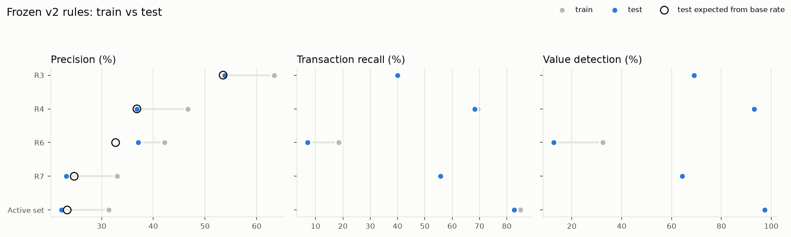
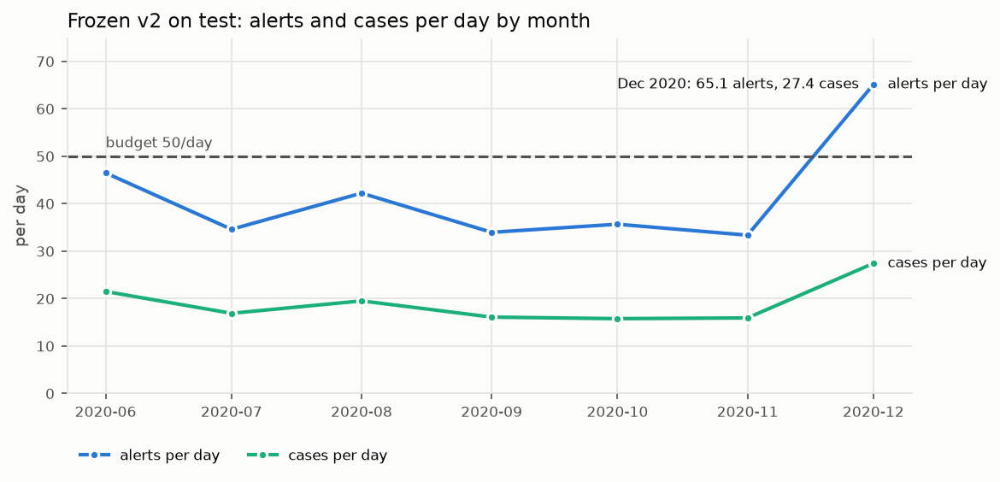

# Post-deployment validation (PVT): rule set v2 on the test period

| Item | Value |
|---|---|
| Rules | Frozen rule set v2, git tag `rules-v2`. Run unchanged; no threshold was changed after this run. |
| Test period | fraudTest.csv: 2020-06-21 12:14:25 to 2020-12-31 23:59:34, 194 days, 555,719 transactions, 2,145 fraud (0.386%), $1,133,324.68 of fraud |
| Training history | Training rows are loaded as unscored history, so card windows continue across the split. Only test rows count in any metric. |
| Sources | `outputs/test/` from `src/run_rules.py --period test`; `outputs/pvt/pvt_rule_comparison.csv` from `src/compare_pvt.py`; charts from `src/make_figures.py`. The v2 comparison table and charts are kept in `reports/pvt_evidence/pvt_rule_comparison_v2.csv` and `reports/figures/pvt_*_v2.png`, because `run_all.py` now regenerates outputs for the current rule set (v2.1). |

## 1. Verdict

| Item | Result | Basis |
|---|---|---|
| Active set (R3, R4, R6, R7) | **Pass** | Recall 82.75% (train 84.92%), value detection 97.41% (98.04%), cases per day 18.78 (17.21). The precision drop is explained by the base rate (section 3). |
| R3 | Pass | Recall 39.91% (39.82%); precision 53.77% against 53.51% expected from the base rate |
| R4 | Pass | Recall 68.25% (69.37%); precision 36.83% against 36.83% expected |
| R7 | Pass, watch | Recall 55.66% (55.74%). Its genuine alert rate rose from 0.659% to 0.715%, so precision (23.18%) is 1.5 points below expected (24.70%). |
| R6 | **Fail on its stated purpose** | Recall fell from 18.40% to 7.04%. It set the first response for 0 of 215 detected cards (28 of 755 in train). Recommend shadow at the next review (section 5). |
| R8 (shadow) | **Do not promote** | 1.12% precision at 31.66 alerts per day; 0 unique fraud catches (section 6) |
| Budget (50 alerts per day) | Met except December | 41.20 alerts and 18.78 cases per day on average. December 2020: 65.13 alerts and 27.42 cases per day (section 4). |

## 2. Active set: train against test

| Metric | Train | Test | Change |
|---|---|---|---|
| Alerts per day | 37.80 | 41.20 | +9.0% |
| Cases per day | 17.21 | 18.78 | +9.1% |
| Precision | 31.40% | 22.21% | -9.19 pts (expected 23.35%, section 3) |
| Genuine alert rate (share of genuine transactions alerted) | 1.080% | 1.123% | +0.043 pts |
| Transaction recall | 84.92% | 82.75% | -2.17 pts |
| Value detection | 98.04% | 97.41% | -0.63 pts |
| Card detection | 755 / 762 (99.08%) | 215 / 218 (98.62%) | -0.46 pts |
| Loss before first alert, median per card | 0 txns / $0 | 0 txns / $0 | none |
| Loss before first alert, P90 per card | 1 txn / $22.21 | 2 txns / $34.42 | +1 txn / +$12.21 |
| Never-alerted compromised cards | 7 | 3 | |
| Fraud amount lost before first alerts | $22,307.20 | $7,154.36 | (smaller period) |

**Per rule** (`pvt_rule_comparison.csv`):

| Rule | Alerts/day (train, test) | Precision (train, test, expected) | Recall (train, test) | Value detection (train, test) | Unique fraud on test |
|---|---|---|---|---|---|
| R3 | 8.78, 8.21 | 63.37%, 53.77%, 53.51% | 39.82%, 39.91% | 68.38%, 68.95% | 3 |
| R4 | 20.76, 20.49 | 46.70%, 36.83%, 36.83% | 69.37%, 68.25% | 93.31%, 93.13% | 316 |
| R6 | 6.09, 2.10 | 42.21%, 37.10%, 32.71% | 18.40%, 7.04% | 32.37%, 12.70% | 0 |
| R7 | 23.60, 26.55 | 33.01%, 23.18%, 24.70% | 55.74%, 55.66% | 63.91%, 64.35% | 290 |

Where a rule is unchanged, the train and test points overlap in the chart below.

## 3. Why precision fell: the base rate
- **Fraud is rarer in test:** 0.386% of transactions against 0.579% in train.
  - Daily fraud fell from 14.0 to 11.1 transactions.
  - Daily transaction volume rose from 2,415 to 2,865 (`profile_period.csv`).
- **The effect on precision:** with fewer frauds among more genuine payments, a rule that is
  exactly as good at separating them will show lower precision.
- **How it was tested:** `compare_pvt.py` computes, for each rule, the precision it would
  have on test if it kept its train recall and its train genuine alert rate.

| | Train precision | Expected on test | Actual on test |
|---|---|---|---|
| Active set | 31.40% | 23.35% | 22.21% |
| R4 | 46.70% | 36.83% | 36.83% |
| R3 | 63.37% | 53.51% | 53.77% |

- **Active set:** 8.05 of the 9.19-point drop is the base rate. The remaining 1.14 points
  come from a slightly higher genuine alert rate (1.080% to 1.123%), mostly in R7.
- **R3 and R4:** precision moved exactly as the base rate predicts. Their behaviour did not
  change.

Drift is therefore judged on recall, value detection and workload. Recall moved by -2.17
points and value detection by -0.63 points. Cases per day rose 9.1%, against an 18.6% rise
in transactions per day.

**The shape of fraud did not change** (`profile_*.csv`, train against test):
- **Hours:** 84.24% of fraud falls in 22:00 to 03:59 (84.76% in train).
- **Spree per card:** median 10 fraud transactions (10), median span 45.25 hours (45.23),
  median $5,292.95 per card ($5,159.15).
- **Categories:** shares are within about 1.3 points of train for every category. The fraud
  rate falls in each category, consistent with the lower overall rate.

## 4. Workload against the budget
Monthly figures are in `monthly_active.csv`:

| Month | Alerts/day | Cases/day | Precision | Recall | Fraud rate |
|---|---|---|---|---|---|
| Jun 2020 (10 days) | 46.50 | 21.50 | 23.66% | 82.71% | 0.442% |
| Jul 2020 | 34.61 | 16.90 | 22.55% | 75.39% | 0.374% |
| Aug 2020 | 42.23 | 19.52 | 26.51% | 83.61% | 0.468% |
| Sep 2020 | 33.97 | 16.10 | 27.97% | 83.82% | 0.489% |
| Oct 2020 | 35.68 | 15.77 | 30.02% | 86.46% | 0.554% |
| Nov 2020 | 33.37 | 15.93 | 24.88% | 84.69% | 0.405% |
| Dec 2020 | 65.13 | 27.42 | 10.40% | 81.40% | 0.185% |

- **Cases:** all 7 months are under 50 per day.
- **Alerts:** December 2020 is over, at 65.13 per day.
- **December repeats the train finding** (74.32 in December 2019). Transaction volume
  spikes while fraud does not: the fraud rate in December 2020 is 0.185%. It is seasonality
  for peak staffing, not a reason to change thresholds.
- **July 2020 has the lowest recall (75.39%).** It is the one month that would justify a
  closer look in monitoring (Phase 7).

## 5. R6: why it decayed
R6 fires on a card's first transaction at a merchant. In test, cards carry about 18 months
of history, so first visits are much rarer (`profile_first_visit.csv`):

| | Train | Test |
|---|---|---|
| Transactions that are a first visit | 36.95% | 9.04% |
| Fraud transactions that are a first visit | 52.22% | 23.22% |
| Median prior transactions per card | 777 | 2,139 |

**Effect on R6 itself:**
- Alerts fell from 6.09 to 2.10 per day and recall from 18.40% to 7.04%.
- Precision held up (37.10%, above the expected 32.71%).

**The approved justification no longer holds:**
- In train, R6 set a stronger first response (STEP_UP instead of ALERT) for 28 of 755
  detected cards (3.71%).
- In test it did so for **0 of 215** (`first_alert_view.csv`).
- As the strongest action across all alerts it covers 72 alerts with 1 fraud ($850.57,
  `action_mix.csv`), and it has 0 unique fraud catches.

**Recommendation:** at the next rule review, move R6 to shadow under the approved rule (0
fraud lost; first-response share below 1%). It is not changed here, because PVT runs the
frozen set unchanged.

**Root cause: R6's train performance was partly a warm-up artifact.** The dataset starts
every card with no history, so early in train almost every transaction is a first visit.
In `profile_first_visit_by_month.csv` the first-visit share falls steadily:
- 94.16% in January 2019
- 12.57% in June 2020
- 7.17% in December 2020

R6's monthly recall falls with it, from 30.83% to 5 to 9%. The train-only check in
`r6_burn_in_check.csv` (analysis only; the rule is not changed) shows the size of the
effect:

| Train segment | First-visit share | R6 alerts/day | R6 precision | R6 recall |
|---|---|---|---|---|
| All train (as tuned) | 36.95% | 6.09 | 42.21% | 18.40% |
| First 3 months (warm-up) | 82.88% | 10.37 | 45.23% | 27.82% |
| Train excluding first 3 months | 29.86% | 5.23 | 41.00% | 16.01% |
| Last 3 months of train | 13.61% | 2.84 | 47.64% | 9.54% |
| Test (PVT, for comparison) | 9.04% | 2.10 | 37.10% | 7.04% |

- **What excluding the warm-up does:** excluding the first 3 months lowers R6's train
  recall from 18.40% to 16.01%.
- **The decay is longer than 3 months:** it continues for the whole training year. Only the
  last months of train (9.54% recall) look like what R6 met on test.
- **Lesson:** a history-dependent rule (new merchant, new device, first-time payee) needs a
  burn-in period excluded from tuning. It should be judged on the most recent window,
  where the history it depends on has stabilised. That is not a fixed 3 months; it depends
  on how fast the underlying feature settles.

This is partly how the simulator generates data (693 merchants that every card cycles
through). In a real portfolio, new merchants keep appearing, so the decay would be slower.

## 6. Shadow rule: R8 risk-list hit
Results are from `rule_performance.csv`, `r8_by_tier.csv` and `unique_catches.csv`.

| Tier | Action if active | Alerts/day | Precision | Recall |
|---|---|---|---|---|
| very_high (2 merchants) | BLOCK | 7.54 | 1.163% | 0.79% |
| high (6 merchants) | HOLD_CONFIRM | 24.12 | 1.111% | 2.42% |
| R8 total | | 31.66 | 1.12% | 3.22% |

- **Lift:** listed merchants are about 2.9 times the base rate (1.12% against 0.386%).
  That is too weak for a BLOCK or HOLD action.
  - Blocking the very_high tier would stop about 85 genuine payments for every fraud.
- **No unique catches:** 0 unique fraud. Every fraud R8 hits, an active rule already
  catches.
- **Cost if made active:** the active set plus R8 would run at 71.66 alerts and 46.65 cases
  per day, against a budget of 50, with no extra detection (recall and value unchanged at
  82.75% and 97.41%).
- **Recommendation:** do not promote. Merchant-level fraud in this data mostly reflects the
  category mix, which R4 already covers.

## 7. Cards with no training history (16 cards)
These 16 cards first appear in the test period and all 16 have fraud
(`pvt_card_groups.csv`, `pvt_test_only_cards.csv`, card numbers masked):

| Group | Compromised cards | Detected | Recall | Value detection | Loss before first alert, median | P90 |
|---|---|---|---|---|---|---|
| Has training history | 202 | 199 (98.51%) | 83.00% | 97.29% | 0 txns / $0 | 2 txns / $41.21 |
| Test-only | 16 | 16 (100.00%) | 79.75% | 98.55% | 1 txn / $8.43 | 1 txn / $12.10 |

- **Every transaction on these cards is fraud:** 163 transactions, no genuine spend before
  the first fraud.
- **Only stateless rules can fire.** R6 needs 10 prior transactions and R7 needs 7 prior
  active days, so neither can fire on these cards. Detection comes from R4 (on the first
  alerted fraud for all 16 cards) and R3 (on 6 of them).
- **The pattern:** for 9 of the 16 cards the first fraud transaction is missed and
  the next one is caught; for the other 7, the first fraud transaction is
  alerted. The missed first transactions are small, which is why the median loss is 1
  transaction but only $8.43.
- **Why it matters:** the R2/R6/R7 "first transaction" gap documented in UAT is real. The
  rule set still covers it here because R3 and R4 need no history.

## 8. Retired rules (monitoring only)
| Rule | Test precision | Test recall | Note |
|---|---|---|---|
| R1 | 7.41% | 1.31% | Weaker than train (21.61%); retirement confirmed |
| R2 | 6.74% | 35.43% | 17 unique fraud on test for 7,757 unique alerts; retirement confirmed |
| R5 | 0.38% | 23.08% | Equal to the test base rate (0.386%); retirement confirmed |

## 9. The test period as a holdout after this report
This PVT is out-of-sample validation for rule set v2 (`rules-v2`), because v2 was frozen
before the test period was run.

The test period is **no longer an independent holdout** for any version changed because of
these findings: R6 to shadow (proposed v2.1), or anything else prompted by sections 4 to 7.
- **How to label those numbers:** any test-period figures reported for such a version are
  an **impact estimate, not out-of-sample validation**.
- **What real validation needs:** a later period that the change did not see. In this
  project that would be new data, or monitoring after go-live.

## 10. Limitations
- **Simulated data.** The shape of fraud is identical in both periods, which a real
  portfolio would not show. This PVT tests stability under a lower fraud rate and higher
  volume, not under new fraud patterns.
- **The test period is 194 days.** December appears once in each period, so the
  seasonality finding rests on two Decembers.
- **The base-rate adjustment assumes a rule's recall and genuine alert rate are its stable
  properties.** It explains precision movement; it does not prove that nothing else
  changed.
- **Net benefit and the budget** keep the assumptions stated in the tuning report ($5 per
  alert; one analyst at about 9 minutes per alert).

## 11. Actions
1. Keep R3, R4 and R7 active unchanged. Watch R7's genuine alert rate in monitoring.
2. **Done:** R6 moved to shadow in rule set v2.1 (2026-11-17, see CHANGELOG). Its
   test-period figures are an impact estimate (section 9): active set 41.02 alerts and
   18.63 cases per day, precision 22.30%, recall 82.75%, value detection 97.41%.
3. Do not promote R8. Rebuild or drop the merchant list at the next review.
4. Plan December peak staffing: about 1.3 analysts on alerts, or one analyst working cases.
5. Add July-style recall dips to the monitoring checks in Phase 7.
