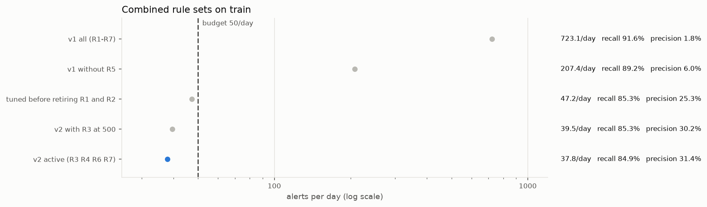
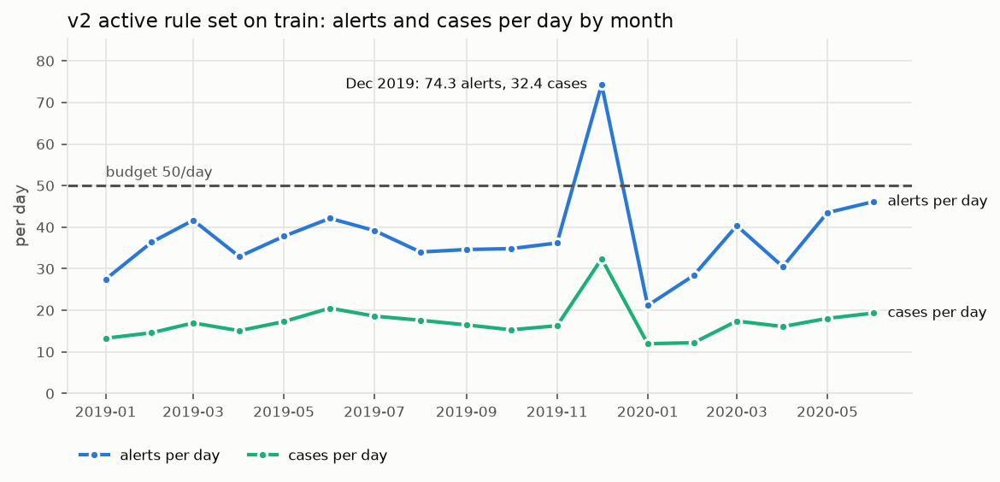
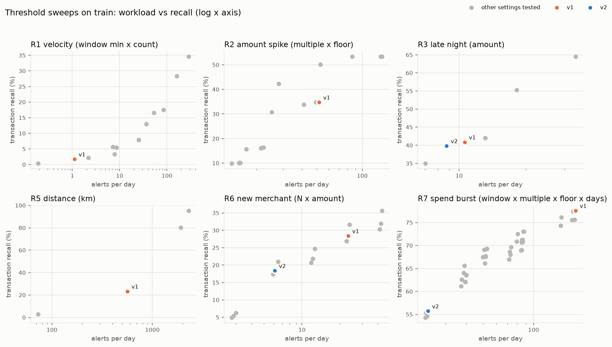
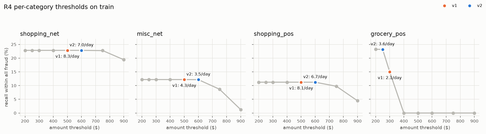
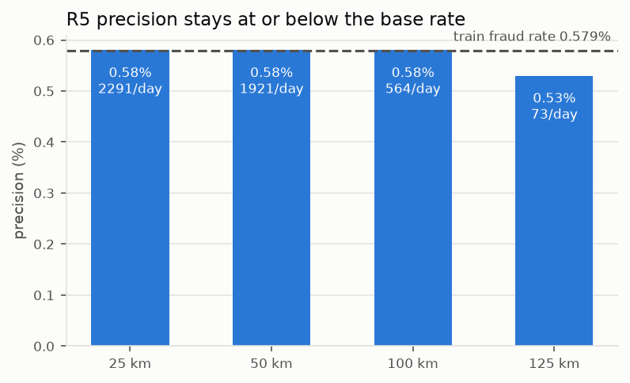

# Tuning report: rule set v2 (training period)

**Status:** rule set v2 is approved and frozen (2026-11-17). No test-period data has been
used for any number or decision in this report. Post-deployment validation (PVT) runs the
frozen set unchanged on the test period.

| Item | Value |
|---|---|
| Data | fraudTrain.csv: 2019-01-01 to 2020-06-21, 537 days, 1,296,675 transactions, 7,506 fraud ($3,988,088.61) |
| Sources | `outputs/train/` from `src/run_rules.py --period train`: sweeps and set comparisons in `sql/40_sweeps_train.sql`; the live v2 metrics in `sql/20` and `sql/30` |
| Review cost for net benefit | $5 per alert |
| Charts | `reports/figures/tuning_*.png` (`src/make_figures.py`) |

## 1. Summary

| | v1 (all seven rules) | v2 active set (R3, R4, R6, R7) |
|---|---|---|
| Alerts per day | 723.12 | 37.80 |
| Cases per day (24 h grouping) | [not measured for v1] | 17.21 |
| Precision | 1.77% | 31.40% |
| False positives per fraud alert | 55.49 | 2.18 |
| Transaction recall | 91.58% | 84.92% |
| Value detection | 98.48% | 98.04% |
| Net benefit at $5 per alert | $1,985,901.78 | $3,808,385.17 |
| Compromised cards detected (of 762) | 760 (99.74%) | 755 (99.08%) |
| Loss before first alert, P90 per card | 1 txn / $128.85 | 1 txn / $22.21 |

The v1 column comes from the Phase 1 run; its alert, precision, recall, value and net
benefit figures are reproduced by set 1 in `candidate_set_comparison.csv`.

**What changed**
- **Retired:** R1, R2 and R5.
- **Re-tuned:** R3, R4, R6 and R7.
- **Built in shadow:** R8 (risk list v1, train only).

**The trade:** v2 cuts the alert volume by 95% for a loss of 6.7 points of transaction
recall and 0.4 points of value detection.

## 2. Alert budget

**Approved budget: 50 alerts per day on average**, measured as distinct alerted
transactions from the active rule set. Cases per day are reported against the same figure.

**Basis:** one fraud analyst with about 7.5 productive hours per day, at roughly 9 minutes
per alert. This is a stated assumption, not a measured handling time.

For scale (derived from the figures above):
- train averages 2,415 transactions and 14.0 fraud transactions per day
- 50 alerts per day is about 2.1% of transactions and 3.6 alerts per fraud transaction, so
  the set needs precision of roughly 28% to cover all fraud inside the budget

**How v2 performs against it** (`monthly_active.csv`):
- **Average:** 37.80 alerts per day and 17.21 cases per day. A case is an alert plus any
  further alerts on the same card within 24 hours of it.
- **By month, alerts:** 17 of 18 months are under budget, from 21.16 to 46.14 per day.
- **By month, cases:** all 18 months are under budget, from 11.97 to 32.42 per day.
- **Peak-staffing finding:** December 2019 runs at 74.32 alerts per day (32.42 cases per
  day).
  - Transaction volume doubles that month: 141,060 transactions against 47,791 to 87,359 in
    the other months.
  - Precision that month (21.57%) is only slightly below the lowest other month (22.88% in
    July 2019), and recall (83.95%) is typical. So the extra alerts come mainly from extra
    volume, not a change in rule behaviour.
  - This is treated as seasonality. It is planned for with peak staffing (about 1.5 analysts
    for December on alerts, or one analyst working cases), not by raising thresholds.

## 3. Per-rule tuning
Each sweep scores every combination in its grid on train. The v1 setting is always part of
the grid, so the comparison is reproducible.

### R1 velocity: retired
The sweep covered windows of 60, 120 and 180 minutes and counts from 3 to 6
(`r1_sweep.csv`).
- Widening the window, as the Phase 1 review suggested, raises recall but lowers precision
  every time:
  - At 120 min, a count of 5 gives 8.60 alerts per day at 8.84% precision and 5.44% recall,
    against 21.61% and 1.72% at 60 min.
  - At 180 min, a count of 3 gives 285.66 per day at 1.69% precision.
- The best precision is 60 min with 6 or more: 27.45%, but only 28 fraud in 537 days.
- Fraud in this data arrives over about 45 hours with a median gap of 65 minutes between
  transactions, so velocity in minutes is not how it shows up.
- **In the tuned set before retirement (set 3),** R1 adds 466 alerts for 5 fraud (1.07%
  marginal precision; net benefit -$1,932.86) (`set3_leave_one_out.csv`).

### R2 amount spike: retired
The sweep covered multiples of 3, 5, 8 and 10, and amount floors of 0 to 500
(`r2_sweep.csv`).
- A floor helps: at 5 times, a $500 floor cuts alerts from 51.91 to 25.24 per day and
  raises precision from 9.36% to 17.05%.
- **Even this tuned version (5 times, amt > 500) adds 4,573 alerts for 25 fraud in set 3**
  (0.55% marginal precision; net benefit -$8,793.62).
- Its catches are almost all made by R4 or R7 first.

### R3 late-night high value: v2.0, amount 500 to 600
From `r3_sweep.csv`:

| Amount | Alerts/day | Precision | Recall |
|---|---|---|---|
| 500 (v1) | 10.60 | 53.88% | 40.87% |
| 600 (v2) | 8.78 | 63.37% | 39.82% |

- **Marginal reasoning** (set 4 against set 5 in `candidate_set_comparison.csv`):
  - Going from $600 back to $500 adds 916 alerts (1.71 per day) and 27 fraud.
  - Recall rises by 0.36 points (84.92% to 85.28%).
  - The extra alerts are about 2.9% precise (27 / 916), against 31.40% for the set as a
    whole. They cost far more analyst time per fraud than the rest of the set, so $600 is
    kept.
- **Unique catches are small** (16 fraud, `unique_catches.csv`). R3 is kept for its action:
  - It fires on the first alerted fraud transaction for 246 of 755 detected cards (32.58%,
    `first_alert_view.csv`).
  - It turns those from a post-event ALERT into a real-time HOLD_CONFIRM.
- UAT-R3-02 ($600.00 at 22:00 alerts) was written for v1 and is superseded in v2; see
  `uat_report.md`.

### R4 risky category + amount: v2.0, per-category thresholds re-tuned
From `r4_sweep.csv`:

| Category | v1 | v2 | Effect on train |
|---|---|---|---|
| grocery_pos | > 300 | > 250 | +798 alerts, +613 fraud (the 250 to 300 band is 76.8% fraud) |
| shopping_net | > 500 | > 600 | -652 alerts, 0 fraud lost |
| misc_net | > 500 | > 600 | -457 alerts, 2 fraud lost |
| shopping_pos | > 500 | > 600 | -768 alerts, 1 fraud lost |

**R4 v2 overall:** 20.76 alerts per day, 46.70% precision, 69.37% recall and 93.31% value
detection, with 1,213 unique fraud catches. It is the single most important rule.
- **Not chosen:** raising shopping_net to 750 would save another 637 alerts for 6 fraud.
  It was left at 600 so that the three online and shopping categories share one threshold.
  At 750 the threshold also sits right at the lower edge of where this simulator puts
  fraud, which is fragile.

### R5 distance anomaly: retired
From `r5_sweep.csv`:
- Precision is 0.58% at 25, 50 and 100 km and 0.53% at 125 km. The train fraud rate is
  0.579%.
- At its v1 setting it raises 563.97 alerts per day, with a net benefit of -$572,954.10.
- The Phase 0 EDA found the same thing: fraud rate is flat across all 25 km bands.
- Its 271 "unique" fraud catches against the v2 set are what any rule firing on 23% of
  transactions would hit by chance.

### R6 new merchant + high amount: v2.0, amount 300 to 750
From `r6_sweep.csv`:

| Setting | Alerts/day | Precision | Recall |
|---|---|---|---|
| N = 10, Y = 300 (v1) | 23.15 | 17.14% | 28.39% |
| N = 10, Y = 750 (v2) | 6.09 | 42.21% | 18.40% |

- **N barely matters:** at Y = 750, N = 5, 10 and 20 give 6.48, 6.09 and 5.89 alerts per
  day.
- **At Y = 1,000, recall collapses to 5.37%,** because almost no fraud in this data is above
  $1,000 at a new merchant. That cut-off would be fitting the simulator.
- **Status decision.** The approved rule: put R6 in shadow if it loses 0 fraud AND is the
  first alert for fewer than 1% of detected cards; otherwise keep it active.
  - **Leave-one-out** (`unique_catches.csv`): removing R6 saves 237 alerts (0.44 per day)
    and loses 0 fraud and $0 of value. The first condition holds.
  - **First alert** (`first_alert_view.csv`): R6's own contribution is the 28 of 755
    detected cards (3.71%) where it sets a stronger first response, STEP_UP instead of
    ALERT. On those cards no HOLD_CONFIRM rule fired on the first alerted fraud, so without
    R6 the first response would have been a post-event review. 3.71% is above 1%, so the
    second condition fails.
  - **Applied: R6 stays active,** on the basis of those 28 cards.
  - **What is not evidence:** R6 also fires on the first alerted fraud for 129 cards
    (17.09%), but that is co-firing. On every one of those cards another active rule fired
    on the same transaction (R6 is never the only rule, 0 cards). On the other 101, R3 or R7
    already set HOLD_CONFIRM, so R6 changes nothing there.
  - Across all alerts, R6 sets the action on 936 alerts (52 fraud, $47,138.14) that would
    otherwise be a post-event ALERT (`action_mix.csv`). It remains the first candidate for
    shadow or retirement at the next review.

### R7 spend burst: v2.0, 24 h / 3x to 48 h / 5x
From `r7_sweep.csv`, 48 settings: window, multiple, spend floor and minimum active days.

| Setting | Alerts/day | Precision | Recall | Value detection |
|---|---|---|---|---|
| 24 h, 3x, 7 days (v1) | 178.01 | 6.09% | 77.58% | 83.49% |
| 24 h, 5x, 7 days | 52.82 | 18.34% | 69.30% | 77.09% |
| 48 h, 4x, 7 days | 39.88 | 22.29% | 63.59% | 70.86% |
| 48 h, 5x, 7 days (v2) | 23.60 | 33.01% | 55.74% | 63.91% |

- **The 48-hour window compares spend with two days of baseline,** so "5x" means five
  times a normal two days.
- **A spend floor changes almost nothing at 48 h:** a $1,000 floor at 5x removes 317
  alerts and 23 fraud. So v2 has no floor.
- **14 minimum active days instead of 7** loses recall in every combination. So 7 stays.
- **In the v2 set,** R7 has 1,093 unique fraud catches. On average it fires 3.54 times per
  case (`case_volume.csv`), because it keeps firing through a spree. Case grouping matters
  most for this rule.

### R8 risk-list hit: built, status shadow
- **The list:** `rules/risk_lists/merchant_risk_v1.csv`, built by
  `src/build_risk_list.py` from train only.
- **Criteria:** at least 500 train transactions and at least 10 fraud; fraud rate at least
  3.5 times the train base rate.
  - 8 merchants: 2 very_high (4 times or more, action BLOCK) and 6 high (3.5 to 4 times,
    action HOLD_CONFIRM).
- **Why shadow:**
  - **The signal is weak.** The highest merchant fraud rate in train is 2.57%. The listed
    merchants are shopping_net and misc_net merchants, which R4 already covers by category.
  - **Train precision is in-sample and can't be used.** Measured on train, the listed
    merchants' transactions are 2.25% fraud (316 of 14,040, summed from the list file). Even that optimistic
    figure would mean blocking about 43 genuine payments for every fraud.
- R8 is evaluated on test only, in PVT, and promotion needs evidence from that run.

## 4. Unique catches and leave-one-out
For each active rule, these are the alerts and fraud it alone produces in the v2 set, which
is exactly what removing it would save and lose (`unique_catches.csv`).

| Rule | Status | Alerts | Unique alerts | Unique fraud | Unique fraud $ |
|---|---|---|---|---|---|
| R3 | active | 4,717 | 238 | 16 | 12,204.02 |
| R4 | active | 11,150 | 4,375 | 1,213 | 477,922.53 |
| R6 | active | 3,272 | 237 | 0 | 0.00 |
| R7 | active | 12,674 | 8,213 | 1,093 | 131,749.83 |
| R1 | retired | 597 | 467 | 5 | 397.14 |
| R2 | retired | 27,877 | 18,561 | 39 | 19,523.54 |
| R5 | retired | 302,851 | 298,117 | 271 | 19,377.19 |

For a retired rule, "unique" means what it would add if reinstated.

## 5. Action mix and first alert
**Strongest action per alerted transaction** (`action_mix.csv`):

| Strongest action | Alerts/day | Precision | Share of all fraud value |
|---|---|---|---|
| HOLD_CONFIRM (R3, R7) | 27.91 | 34.08% | 84.87% |
| ALERT (R4 only) | 8.15 | 27.73% | 11.98% |
| STEP_UP (R6, without R3 or R7) | 1.74 | 5.56% | 1.18% |

85% of fraud value is met by a real-time action (hold and confirm) rather than a review
after the payment.

**First alert per card** (`first_alert_view.csv`), for the 755 detected cards:

| Rule | Fired on the card's first alerted fraud | Was the only rule | Its action was the strongest |
|---|---|---|---|
| R4 | 739 | 464 | 464 |
| R3 | 246 | 10 | 246 |
| R6 | 129 | 0 | 28 |
| R7 | 51 | 2 | 51 |

R7 rarely fires first, because its 48-hour spend needs a few fraud transactions to build
up. R4 and R3 catch the first transaction; R7 catches the cards they miss.

## 6. Loss before first alert (v2 active set)
From `loss_before_first_alert.csv`:
- **Detection:** 762 compromised cards; 7 never alerted.
- **Median loss** before the first alerted fraud: 0 transactions and $0.
- **P90:** 1 transaction and $22.21.
- **Total fraud before first alerts:** $22,307.20.

## 7. Limitations
- **Simulated data.** Fraud sits in narrow category, hour and amount bands. The v2
  thresholds sit close to those bands: R4 at $600, grocery_pos at $250, R6 at $750. Real
  fraud will not respect them, and these results overstate real-world precision.
- **No upper amount caps were used.** Train has no fraud above $1,500; a cap would be
  fitting the generator.
- **Net benefit assumes a lot:** every alert costs $5, and catching a fraud transaction
  recovers its full amount. It ignores customer friction from STEP_UP and HOLD_CONFIRM.
- **The budget is assumption-based** (one analyst, about 9 minutes per alert), not measured.
- **The rule set was chosen by comparing a handful of hand-picked sets,** not by an
  exhaustive search.
- **Retired rules are retired on this data.** Velocity (R1) and distance (R5) matter for
  card-testing and card-present fraud, which this simulator does not generate.

## 8. Decisions (approved 2026-11-17)
1. **Rule set v2:** R3, R4, R6 and R7 active (R6 by the rule in section 3); R1, R2 and R5
   retired; R8 in shadow.
2. **R3 stays at $600** (marginal reasoning in section 3). UAT-R3-02 is superseded.
3. **Budget:** 50 alerts per day as a stated assumption. Cases per day are reported against
   it. December is a peak-staffing finding, not a threshold change.
4. **R8 in shadow** for PVT.
5. **Frozen as rule set v2.** The previous set (R1 to R7 at v1.0/v1.1) can be reproduced
   from git tag `rules-v1.1`.
